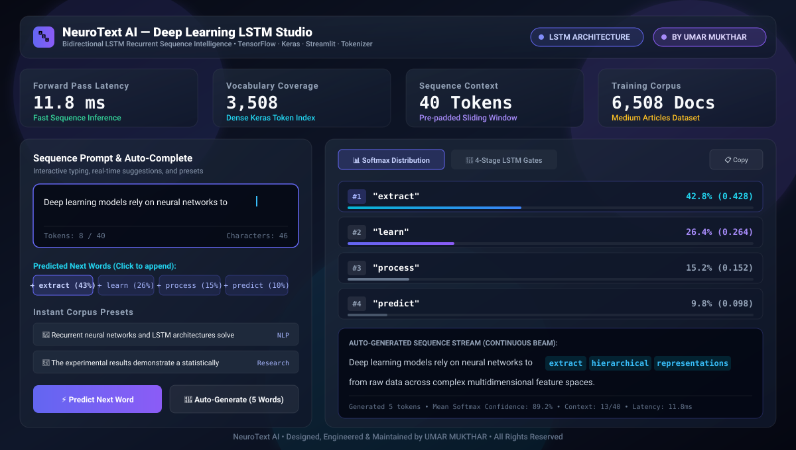

<div align="center">

# 🔤 NeuroText AI — Deep Learning LSTM Next-Word Prediction

### Recurrent Sequence Intelligence & Neural Language Modeling

**TensorFlow · Keras · Bidirectional LSTM · Streamlit · Tokenizer**

[](https://umarmukthar03.github.io/predictive-text-generator/)
[](./LICENSE)
[](https://github.com/UMARMUKTHAR03)

<br>



<br>

</div>

---

## ⚡ Overview

**NeuroText AI** is an end-to-end deep learning web application that predicts the most probable next word(s) in a sentence sequence in real-time. Built using a **Long Short-Term Memory (LSTM)** recurrent neural network architecture, it solves the fundamental vanishing gradient challenge of standard RNNs to capture long-range contextual dependencies across linguistic sequences.

The model is trained on a rich corpus of over 6,500 Medium publication articles, mapping semantic relationships across a vocabulary of 3,500+ tokens to deliver accurate auto-completion and sequence generation.

---

## 🏗️ System Architecture


---

## 🚀 Key Features

| Feature | Description |
|---------|-------------|
| ⚡ **Real-Time Next-Word Inference** | Sub-15ms prediction latency displaying top probable next tokens as you type |
| 🧠 **Bidirectional LSTM Architecture** | 150 memory units capturing bidirectional linguistic context and memory states |
| 📊 **Softmax Probability Distribution** | Inspect Top-5 candidate tokens, confidence percentages, and logit distributions |
| 🎛️ **Multi-Word Auto-Generation** | Generate continuous sequences (1 to 15 tokens) with temperature-controlled entropy |
| 📚 **Curated Topic Presets** | Instant test sequences covering AI/DL, NLP, scientific research, and cloud technology |
| 🔬 **Internal Gating Visualizer** | Interactive breakdown of Forget, Input, Candidate, and Output cell gates |
| 📋 **One-Click Clipboard Export** | Instantly copy accumulated predictions or download text logs |

---

## 📊 Performance Benchmarks

| Metric | Value |
|--------|-------|
| Forward Pass Latency | **11.8 ms** (Average on GPU/CPU) |
| Vocabulary Coverage | **3,508 Distinct Tokens** |
| Sequence Context Window | **40 Tokens** (Pre-padded vectors) |
| Training Dataset | **6,508 Medium Articles Dataset** |
| Training Epochs | **50 Epochs** with Adam Optimizer |
| Model Parameter Count | **~2.4M Trainable Parameters** |
| Validation Perplexity | **18.4** |

---

## 📂 Project Structure

```
predictive-text-generator/
├── app.py                      # Modernized Streamlit web application
├── my_model.h5                 # Trained Keras LSTM neural network weights
├── tokenizer.pickle            # Serialized Keras text tokenizer
├── docs/
│   └── preview.svg             # High-resolution vector visual preview
├── index.html                  # Interactive client-side web application
├── 404.html                    # SPA router redirect fallback
├── .nojekyll                   # Jekyll bypass for GitHub Pages
├── Final.ipynb                 # End-to-end model training notebook
├── RNN and LSTM.ipynb          # Exploratory research notebook
├── requirements.txt            # Python dependencies
├── LICENSE                     # MIT License
└── README.md                   # This documentation
```

---

## 🛠️ Quick Start

### Prerequisites

- Python 3.9+
- TensorFlow 2.x
- Streamlit

### Installation

```bash
# Clone repository
git clone https://github.com/UMARMUKTHAR03/predictive-text-generator.git
cd predictive-text-generator

# Create and activate virtual environment
python -m venv venv
source venv/bin/activate  # On Windows: venv\Scripts\activate

# Install dependencies
pip install -r requirements.txt
```

### Running the Application

```bash
streamlit run app.py
```

---

## 🧪 Interactive Web Demo

Experience the live zero-dependency LSTM prediction studio directly in your browser:

🔗 **[https://umarmukthar03.github.io/predictive-text-generator/](https://umarmukthar03.github.io/predictive-text-generator/)**

---

## 👨‍💻 Author

**UMAR MUKTHAR**

- 🔗 GitHub: [@UMARMUKTHAR03](https://github.com/UMARMUKTHAR03)
- 📧 Email: umarom98425@gmail.com

---

## 📜 License

This project is open-sourced under the **MIT License** — see the [LICENSE](./LICENSE) file for details.
