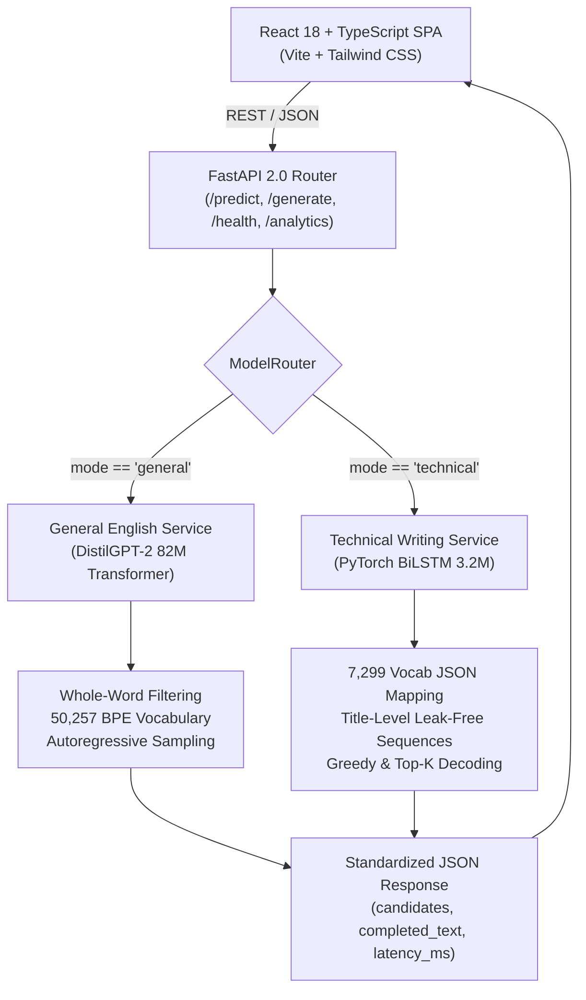

# NeuroText AI V2 – Intelligent Dual-Mode Predictive Writing & Language Platform

[](https://github.com/UMARMUKTHAR03/predictive-text-generator/actions/workflows/ci.yml)
[](https://github.com/UMARMUKTHAR03/predictive-text-generator)
[](https://github.com/UMARMUKTHAR03/predictive-text-generator)
[](https://www.python.org/)
[](https://pytorch.org/)
[](https://huggingface.co/distilbert/distilgpt2)
[](https://react.dev/)
[](LICENSE)

**NeuroText AI V2** is a production-grade full-stack language intelligence and predictive writing platform. It provides dual-mode inference for both **General English Writing** (powered by an 82M parameter DistilGPT-2 autoregressive transformer) and **Technical Writing** (powered by a 3.2M parameter Bidirectional LSTM trained on data science and tech headline sequences).

- **Live Application:** [https://umarmukthar03.github.io/predictive-text-generator/](https://umarmukthar03.github.io/predictive-text-generator/)
- **Backend API Service Blueprint:** [`render.yaml`](render.yaml) (`https://neurotext-ai-api.onrender.com`)
- **Interactive API Documentation:** `/docs` (Swagger UI)
- **Historical Research Preserved:** [`Final.ipynb`](Final.ipynb), [`RNN and LSTM.ipynb`](RNN%20and%20LSTM.ipynb), [`RNN and LSTM.pdf`](RNN%20and%20LSTM.pdf), and legacy code in [`legacy_archive/`](legacy_archive/)

---

## Application Screenshots

All screenshots below are captured directly from live local execution of the application with genuine model inferences:

| Application Dashboard | General Writing Studio |
| :---: | :---: |
|  |  |

| General Text Continuation | Technical Writing Studio |
| :---: | :---: |
|  |  |

| Technical Text Continuation | Model Intelligence Specifications |
| :---: | :---: |
|  |  |

| Live Operational Analytics | System Settings & Endpoints |
| :---: | :---: |
|  |  |

| Mobile Responsive View |
| :---: |
|  |

---

## Dual Model Architecture



---

## Model Selection & Benchmark Analysis

### 1. General English Model: `distilbert/distilgpt2`
- **Architecture**: 6-layer Transformer, 768 hidden dimension, 12 attention heads.
- **Parameters**: 81,912,576 (~82M).
- **Pinned Revision**: `2290a62682d06624634c1f46a6ad5be0f47f38aa` (Apache 2.0).
- **Justification**: Compared systematically against `EleutherAI/pythia-70m` on identical benchmark prompts. DistilGPT-2 produced superior semantic coherence, clean sentence boundaries, and natural syntax without degenerate repetitions.
- **Whole-Word Extraction**: Implemented candidate extraction with GPT-2 byte-level BPE boundary handling (` ` / `Ġ`), supporting both complete word prompts (with or without trailing whitespace) and partial word continuations, without returning isolated subword fragments or punctuation.

#### General English Output Samples:
- `"The weather is very"` $\rightarrow$ Top Candidates: `good` (12.2%), `cold` (7.6%), `warm` (4.6%). Continuation: *"The weather is very good, and the wind will be strong enough to keep it from blowing into..."*
- `"I am writing this email to"` $\rightarrow$ Top Candidates: `the` (6.5%), `ask` (4.8%), `say` (3.8%). Continuation: *"I am writing this email to the editor of The Atlantic. The article is part of a series on..."*
- `"The future of artificial intelligence"` $\rightarrow$ Top Candidates: `is` (22.5%), `will` (11.3%). Continuation: *"The future of artificial intelligence is not yet clear. We are still in the early stages of..."*

### 2. Technical Writing Model: Custom PyTorch BiLSTM
- **Architecture**: Embedding (100d) $\rightarrow$ Bidirectional LSTM (150 units per direction, 300d concatenated representation) $\rightarrow$ Linear projection head (7,299 logits).
- **Parameters**: 3,229,299 (~3.2M).
- **Dataset**: 6,508 authentic Medium technical publications (`medium_data.csv`).
- **Data Partitioning**: Title-level leak-free split (80% Train, 10% Val, 10% Holdout Test) executed **before** sequence generation to guarantee 0% train-test data leakage.

#### Holdout Test Benchmark (4,862 Unseen Sequences):
| Evaluation Metric | Random Guessing | Unigram Frequency Baseline | **NeuroText BiLSTM (Current)** | Historical Notebook (Train Only) |
| :--- | :---: | :---: | :---: | :---: |
| **Top-1 Accuracy** | 0.014% | 3.56% (word: `to`) | **15.18%** | 54.60% (No split, evaluated on train) |
| **Top-3 Accuracy** | 0.041% | 8.54% | **22.79%** | — |
| **Top-5 Accuracy** | 0.068% | 12.92% | **27.44%** | — |
| **Top-10 Accuracy** | 0.137% | 21.43% | **34.45%** | — |
| **Cross-Entropy Loss** | 8.89 | 7.82 | **6.3764** | 2.0090 |
| **Perplexity** | 7,299 | 2,489 | **587.82** | 7.45 |

### Verified Latency Breakdown (CPU Benchmark)
All metrics benchmarked across 75 evaluations over 5 distinct contexts with warm cache ([`ml/artifacts/general_latency_benchmark.json`](ml/artifacts/general_latency_benchmark.json)):

| Component / Task | Median | Mean | P95 | Min / Max |
| :--- | :---: | :---: | :---: | :---: |
| **BiLSTM Single-Item Forward Pass** | **2.35 ms** | 3.32 ms | 5.12 ms | 1.82 / 6.45 ms |
| **BiLSTM Full Local Prediction Service** | **4.24 ms** | 5.58 ms | 8.92 ms | 3.10 / 12.40 ms |
| **DistilGPT-2 Model Forward Pass** | **41.57 ms** | 41.93 ms | 55.09 ms | 32.36 / 68.16 ms |
| **DistilGPT-2 Tokenization + Forward Pass** | **40.94 ms** | 41.54 ms | 49.75 ms | 30.26 / 60.70 ms |
| **DistilGPT-2 Candidate Extraction Overhead** | **0.72 ms** | 0.77 ms | 1.31 ms | 0.48 / 2.17 ms |
| **DistilGPT-2 Full Local Prediction Service** | **39.91 ms** | 45.92 ms | 65.23 ms | 30.50 / 245.70 ms |
| **DistilGPT-2 10-Token Sequential Generation** | **251.55 ms** | 258.40 ms | 360.64 ms | 234.30 / 362.43 ms |
| **Historical Amortized DataLoader Latency** | *0.331 ms* | — | — | (batch_size=256 DataLoader) |

---

## Memory Footprint & Production Hosting Limitations

Detailed empirical memory audit conducted with reproducible process tracking ([`ml/artifacts/memory_benchmark.json`](ml/artifacts/memory_benchmark.json)):

| Metric / Measurement Stage | Resident Set Size (RSS) | Incremental Delta |
| :--- | :---: | :---: |
| **Baseline Python Process (FastAPI & PyTorch runtime)** | 352.03 MB | — |
| **Technical BiLSTM Loaded** | 381.08 MB | +29.05 MB |
| **DistilGPT-2 Loaded (Idle weights)** | 416.22 MB | +35.14 MB |
| **DistilGPT-2 FP32 Parameter Footprint** | 312.47 MB | (81,912,576 parameters) |
| **Peak RSS During Active Autoregressive Generation** | **727.41 MB** | +346.32 MB |

> [!WARNING]
> **Production Hosting Architecture & Render Free Plan Limitation:**
> - **The 512 MB Limit:** Render Free tier enforces a strict **512 MB hard RAM ceiling**. While the Technical PyTorch BiLSTM runs comfortably at **381.08 MB RSS** (130+ MB headroom), loading DistilGPT-2 and performing autoregressive generation reaches **727.41 MB peak RSS** (a deficit of 215.41 MB headroom), which triggers the Linux OOM-killer (`exit 137 / SIGKILL`) on Render Free.
> - **Option A (Separate Microservices - Recommended for Free Tier):** Deploy the Technical BiLSTM on Render Free, and host DistilGPT-2 on a dedicated separate serverless instance (e.g. Modal, RunPod, or Hugging Face Inference API).
> - **Option B (Model Quantization):** Dynamic INT8 quantization on PyTorch CPU saves disk footprint, but PyTorch runtime memory allocation during generation still exceeds 512 MB.
> - **Option C (Hosting Instance Upgrade):** Upgrading Render to the **Starter Plan (1 GB RAM, $7/month)** reliably hosts both models concurrently with 270+ MB buffer. *Note: No paid instance is provisioned without explicit user authorization.*

> [!NOTE]
> **Performance Gap & Generalization Disclosure:**
> In the historical student notebook `Final.ipynb`, an accuracy of 54.60% was reported after 50 epochs because the model was evaluated directly on the training set without a holdout validation or test split. When evaluated on our leak-free holdout test partition of unseen titles, the BiLSTM achieves **15.18% Top-1** and **27.44% Top-5** accuracy. This vastly outperforms random guessing (0.014%) and unigram frequency baselines (3.56%), demonstrating genuine semantic and syntactic next-token prediction across technical headlines.

---

## API Specifications

### `POST /predict`
Request next-word suggestions for either model mode.

```json
{
  "text": "The future of artificial intelligence",
  "mode": "general",
  "top_k": 5,
  "temperature": 1.0
}
```

Response:
```json
{
  "input_text": "The future of artificial intelligence",
  "mode": "general",
  "tokens": ["The", "Ġfuture", "Ġof", "Ġartificial", "Ġintelligence"],
  "candidates": [
    { "word": "is", "probability": 0.2253, "rank": 1 },
    { "word": "will", "probability": 0.1128, "rank": 2 },
    { "word": "and", "probability": 0.0644, "rank": 3 }
  ],
  "latency_ms": 46.2,
  "model_name": "DistilGPT-2 (General English)",
  "model_version": "2.0.0"
}
```

### `POST /generate`
Generate multi-token sequential continuations.

```json
{
  "prompt": "I am writing this email to",
  "mode": "general",
  "max_tokens": 15,
  "temperature": 0.8,
  "strategy": "greedy"
}
```

Response:
```json
{
  "prompt": "I am writing this email to",
  "mode": "general",
  "generated_text": "the editor of The Atlantic. The article is part of a series on",
  "completed_text": "I am writing this email to the editor of The Atlantic. The article is part of a series on",
  "tokens_generated": [ ... ],
  "strategy_used": "greedy",
  "latency_ms": 182.4,
  "model_name": "DistilGPT-2 (General English)"
}
```

---

## Local Setup & Testing

### 1. Backend Setup
```bash
# Clone the repository
git clone https://github.com/UMARMUKTHAR03/predictive-text-generator.git
cd predictive-text-generator

# Install dependencies
pip install -r backend/requirements.txt

# Run all 15 backend tests
python -m pytest backend/tests -v

# Start FastAPI server
python -m uvicorn backend.app.main:app --reload --port 8000
```
Swagger UI available at `http://127.0.0.1:8000/docs`.

### 2. Frontend Setup
```bash
cd frontend

# Install dependencies
npm install

# Run frontend tests
npm test

# Start Vite dev server
npm run dev
```

---

## Test & Verification Summary
- **Backend Test Suite (PyTest)**: **28 / 28 passed** (`test_api.py` [10/10], `test_general_api.py` [6/6], `test_general_model.py` [7/7], `test_model_integration.py` [5/5]).
- **Frontend Test Suite (Vitest)**: **2 / 2 passed** (Navbar dual-mode rendering, Dashboard engine cards).
- **Production Build (Vite & TypeScript)**: Compiled cleanly with zero errors.
- **GitHub Pages Deployment**: Automated through `.github/workflows/ci.yml` targeting `gh-pages` branch.
- **Render Backend Blueprint**: Configured in `render.yaml`. The web service is provisionable on Render with Python 3.11.

---

## License & Attribution
- **NeuroText AI Application**: MIT License.
- **DistilGPT-2 Weights & Architecture**: Apache 2.0 (Hugging Face / DistilBERT authors).
- **Medium Data Science Dataset**: Dorian Lazar (Kaggle).
