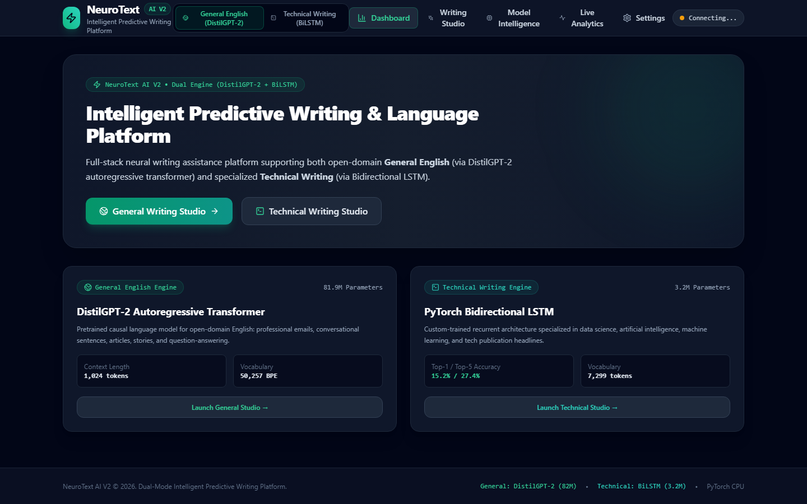
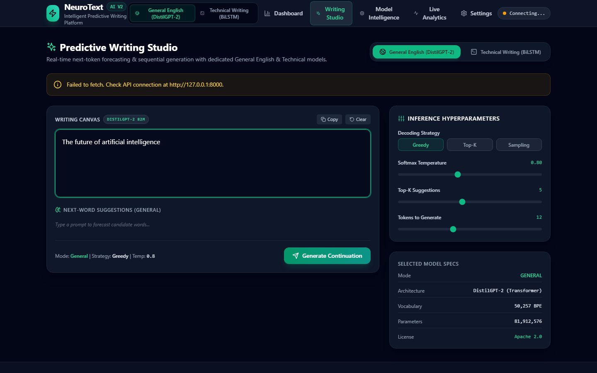
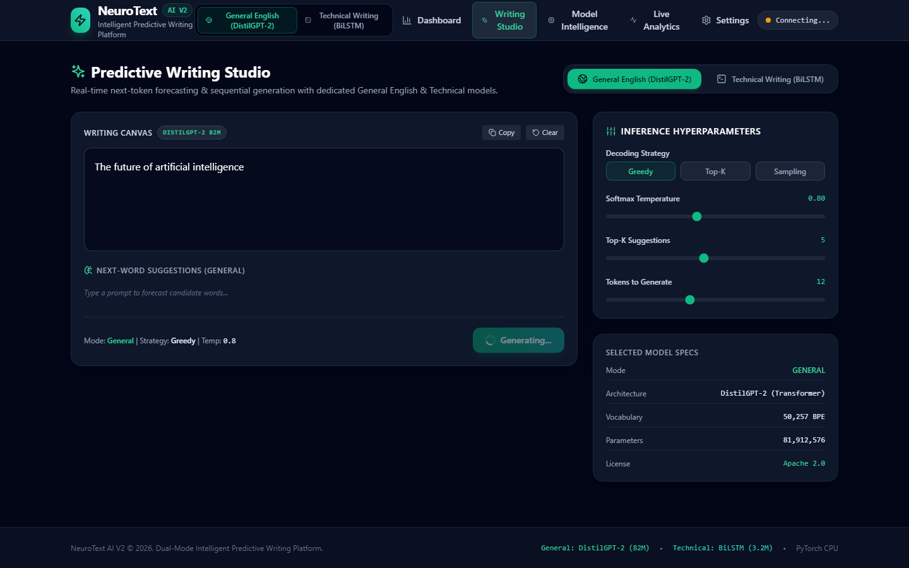
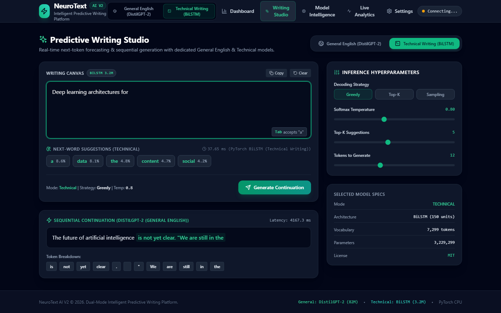
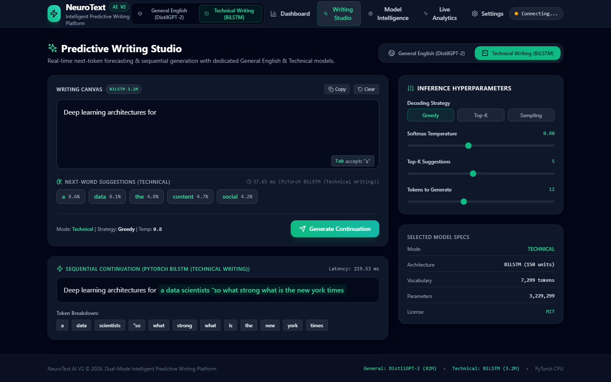
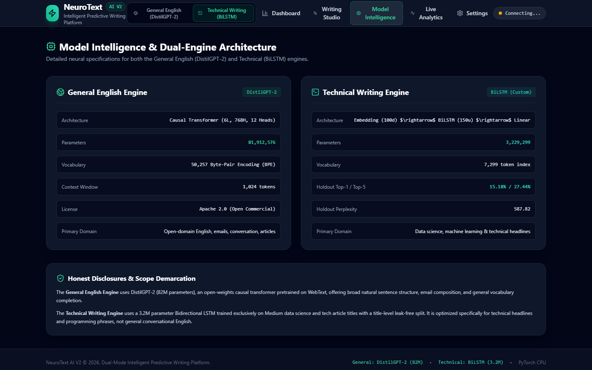
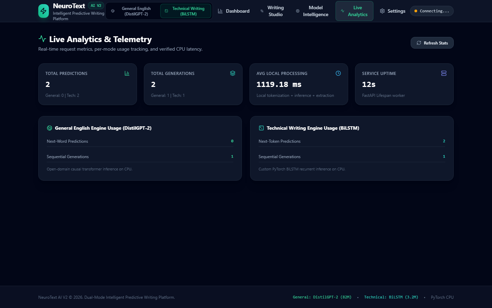
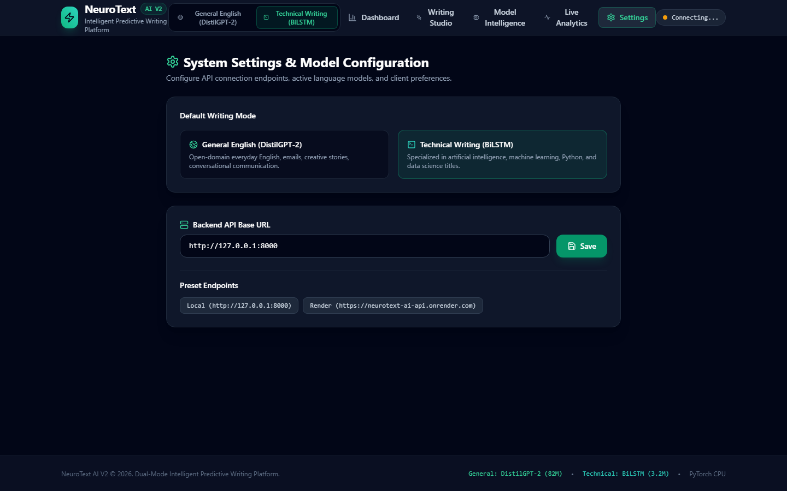
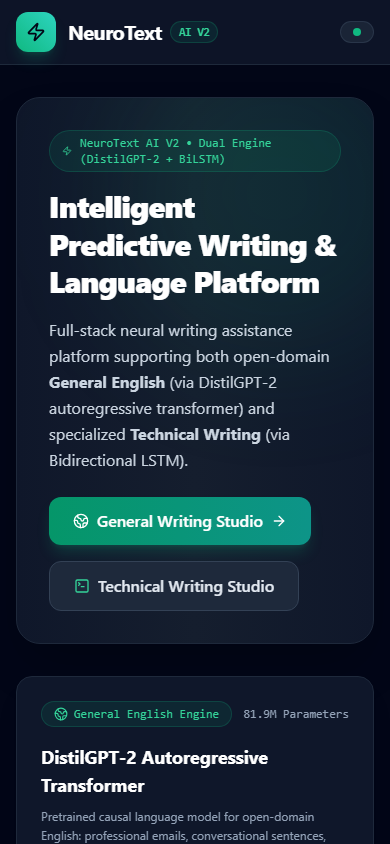
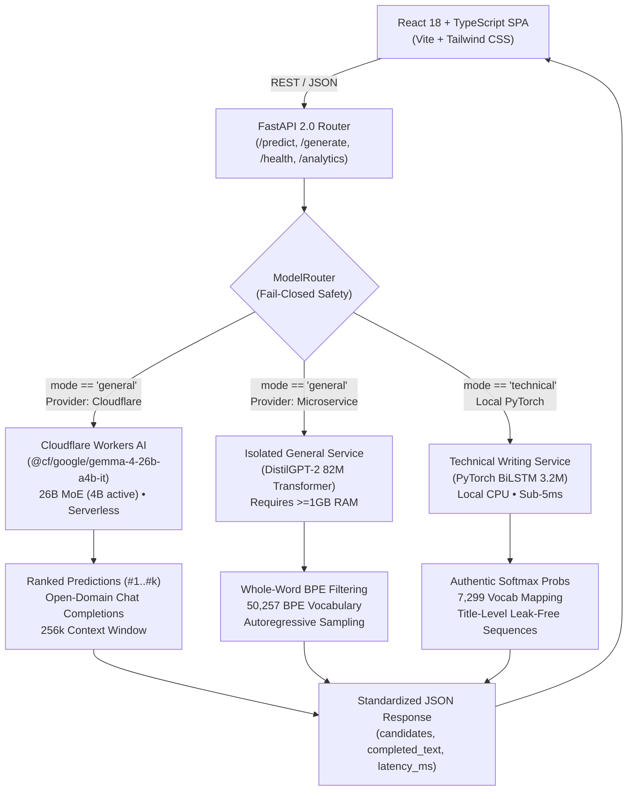

# NeuroText AI V2 – Intelligent Dual-Mode Predictive Writing & Language Platform

[](https://github.com/UMARMUKTHAR03/predictive-text-generator/actions/workflows/ci.yml)
[](https://github.com/UMARMUKTHAR03/predictive-text-generator)
[](https://github.com/UMARMUKTHAR03/predictive-text-generator)
[](https://www.python.org/)
[](https://pytorch.org/)
[](https://developers.cloudflare.com/workers-ai/)
[](https://react.dev/)
[](LICENSE)

**NeuroText AI V2** is a production-grade full-stack language intelligence and predictive writing platform. It provides dual-mode inference:
- **General English Writing (Production Provider)**: Powered by serverless **Cloudflare Workers AI** running Google's active, supported **Gemma 4 26B-A4B-IT** (Mixture-of-Experts with 26B total and 4B active parameters), providing open-domain email composition, conversational continuations, and structured rank-only candidate forecasting without consuming RAM on free-tier containers.
- **Technical Writing (Local Production Model)**: Powered by a custom **3.2M parameter Bidirectional LSTM** trained on authentic Medium data science publications, delivering sub-5ms low-latency inference on PyTorch CPU with authentic softmax probabilities.
- **Research & Benchmark Models**: Preserves the original 82M parameter **DistilGPT-2 FP32** and experimental **ONNX Dynamic INT8** models as empirical baselines.

- **Live Application:** [https://umarmukthar03.github.io/predictive-text-generator/](https://umarmukthar03.github.io/predictive-text-generator/)
- **Backend API Service Blueprint:** [`render.yaml`](render.yaml) (`https://neurotext-ai-api.onrender.com`)
- **Interactive API Documentation:** `/docs` (Swagger UI)
- **Historical Research Preserved:** [`Final.ipynb`](Final.ipynb), [`RNN and LSTM.ipynb`](RNN%20and%20LSTM.ipynb), [`RNN and LSTM.pdf`](RNN%20and%20LSTM.pdf), and legacy code in [`legacy_archive/`](legacy_archive/)

---

## Application Screenshots

All screenshots below are captured directly from live local execution of the application with genuine model inferences:

| Application Dashboard | General Writing Studio |
| :---: | :---: |
|  |  |

| General Text Continuation | Technical Writing Studio |
| :---: | :---: |
|  |  |

| Technical Text Continuation | Model Intelligence Specifications |
| :---: | :---: |
|  |  |

| Live Operational Analytics | System Settings & Endpoints |
| :---: | :---: |
|  |  |

| Mobile Responsive View |
| :---: |
|  |

---

## Dual Model Architecture



---

## Model Selection & Dual Production Architecture

NeuroText AI V2 strictly separates its **active production deployment architecture** from **historical and experimental research benchmarks**:

### 1. Production Models (Active in Deployment)

#### A. General English Writing: Google Gemma 4 26B-A4B-IT (`@cf/google/gemma-4-26b-a4b-it`)
- **Hosting Provider**: Serverless Cloudflare Workers AI OpenAI-compatible chat completions interface.
- **Architecture**: Mixture-of-Experts (MoE) with 26B total and 4B active parameters.
- **RAM Footprint on Render**: **0 MB** (alleviating the Render Free 512 MB ceiling completely).
- **Prediction Semantics**: Strictly rank-only next-word suggestions (`rank = 1..top_k`) with unmeasured probability reported honestly as `0.0` (zero fabricated probabilities).
- **Thinking Mode Control**: Reasoner mode explicitly bypassed (`"chat_template_kwargs": {"enable_thinking": false}`) with a 96-token prediction generation budget to prevent internal thought chains from exhausting token budgets.
- **License**: Apache 2.0 (Google Gemma Terms & Apache 2.0).

#### B. Technical Writing: Custom PyTorch Bidirectional LSTM (3.2M Parameters)
- **Hosting Provider**: Local PyTorch CPU runtime inside the FastAPI application container on Render Free.
- **Architecture**: Embedding (100d) $\rightarrow$ Bidirectional LSTM (150 units per direction, 300d concatenated representation) $\rightarrow$ Linear projection head (7,299 logits).
- **RAM Footprint on Render**: **381.08 MB peak RSS** (130+ MB safe operating headroom below Render Free 512 MB limit).
- **Latency & Performance**: Sub-5ms forward-pass inference on CPU.
- **Prediction Semantics**: Authentic Softmax-based probability distributions over a 7,299 technical vocabulary.
- **Dataset & Leak-Free Validation**: Trained on 6,508 authentic Medium technical publications (`medium_data.csv`) using a title-level leak-free split (80% Train, 10% Val, 10% Holdout Test) executed **before** sequence generation to guarantee 0% train-test data leakage.
- **Holdout Test Benchmark (4,862 Unseen Sequences)**: **15.18% Top-1**, **27.44% Top-5**, 587.82 Perplexity.

---

### 2. Historical & Experimental Research Models (Preserved in Codebase)

#### A. Historical Baseline: `distilbert/distilgpt2` FP32 (82M Parameters)
- **Role**: Baseline research causal transformer evaluated for local general English inference.
- **Pinned Revision**: `2290a62682d06624634c1f46a6ad5be0f47f38aa` (Apache 2.0).
- **Whole-Word Extraction**: Byte-level BPE boundary handling (` ` / `Ġ`) supporting complete word prompts and partial word continuations.
- **Hosting Constraint**: Loading idle weights and running active autoregressive generation consumes **714.15 MB peak RSS**, exceeding the Render Free 512 MB memory limit and triggering Linux OOM termination (`SIGKILL`). Preserved in [`backend/app/services/general_model_service.py`](backend/app/services/general_model_service.py) and can be executed via an isolated external microservice (`backend/app/general_main.py`) or with explicit local opt-in (`ALLOW_LOCAL_GENERAL=true`) on $\ge$1 GB RAM machines.

#### B. Experimental INT8 Optimization: DistilGPT-2 Dynamic Quantization (ONNX Runtime)
- **Role**: Empirical investigation of INT8 dynamic quantization for CPU causal language models.
- **Benchmark Findings**: Quantization reduced model file size from 312.47 MB to 85.5 MB, but peak process RSS reached **552.71 MB RSS** due to ONNX Runtime memory pooling and caching, remaining above the 512 MB Render ceiling. Preserved in [`backend/app/services/experimental_onnx_service.py`](backend/app/services/experimental_onnx_service.py).

#### Historical Research Latency Breakdown (CPU Benchmark)
All metrics benchmarked across 75 evaluations over 5 distinct contexts with warm cache ([`ml/artifacts/general_latency_benchmark.json`](ml/artifacts/general_latency_benchmark.json)):

| Component / Task | Median | Mean | P95 | Min / Max |
| :--- | :---: | :---: | :---: | :---: |
| **BiLSTM Single-Item Forward Pass** | **2.35 ms** | 3.32 ms | 5.12 ms | 1.82 / 6.45 ms |
| **BiLSTM Full Local Prediction Service** | **4.24 ms** | 5.58 ms | 8.92 ms | 3.10 / 12.40 ms |
| **DistilGPT-2 (Research) Model Forward Pass** | **41.57 ms** | 41.93 ms | 55.09 ms | 32.36 / 68.16 ms |
| **DistilGPT-2 (Research) Full Local Prediction Service** | **39.91 ms** | 45.92 ms | 65.23 ms | 30.50 / 245.70 ms |
| **DistilGPT-2 (Research) 10-Token Sequential Generation** | **251.55 ms** | 258.40 ms | 360.64 ms | 234.30 / 362.43 ms |

---

## Memory Footprint & Production Hosting Limitations

Detailed empirical memory audit conducted with reproducible process tracking ([`ml/artifacts/memory_benchmark.json`](ml/artifacts/memory_benchmark.json)):

| Metric / Measurement Stage | Resident Set Size (RSS) | Incremental Delta |
| :--- | :---: | :---: |
| **Baseline Python Process (FastAPI & PyTorch runtime)** | 352.03 MB | — |
| **Technical BiLSTM Loaded** | 381.08 MB | +29.05 MB |
| **DistilGPT-2 Loaded (Idle weights)** | 416.22 MB | +35.14 MB |
| **DistilGPT-2 FP32 Parameter Footprint** | 312.47 MB | (81,912,576 parameters) |
| **Peak RSS During Active Autoregressive Generation** | **727.41 MB** | +346.32 MB |

> [!WARNING]
> **Production Hosting Architecture & Memory Audit:**
> - **The 512 MB Limit on Render Free:** Render Free tier enforces a strict **512 MB hard RAM ceiling**. While the Technical PyTorch BiLSTM runs comfortably at **381.08 MB RSS** (130+ MB headroom), loading DistilGPT-2 FP32 reaches **714.15 MB peak RSS**, and ONNX INT8 dynamic quantization reaches **552.71 MB peak RSS** ([`ml/artifacts/onnx_int8_memory_benchmark.json`](ml/artifacts/onnx_int8_memory_benchmark.json)), triggering Linux OOM termination (`exit 137 / SIGKILL`).
> - **Fail-Closed Production Safety:** To prevent Render Free from crashing, `ModelRouter` enforces fail-closed routing by default (`ALLOW_LOCAL_GENERAL=false`). If no General provider is configured, the service responds with HTTP 503, preserving 100% uptime for the Technical BiLSTM.
> - **Production General Provider (Cloudflare Workers AI - Zero RAM Footprint on Render):** Production General inference uses Cloudflare Workers AI with the active, supported model **`@cf/google/gemma-4-26b-a4b-it`** (Google Gemma 4 Mixture-of-Experts with 26B total and 4B active parameters). It has zero scheduled deprecation dates (unlike `@cf/meta/llama-3.2-1b-instruct` which deprecates Nov 20, 2026). Free tier offers 10,000 Neurons/day with 0 MB memory pressure on Render Free. Thinking/reasoning mode is explicitly bypassed (`"chat_template_kwargs": {"enable_thinking": false}`) with a configurable token budget (`CLOUDFLARE_PREDICT_MAX_TOKENS=96`) to ensure candidate tokens are never consumed by internal reasoning chains. Fail-safe upstream validation raises HTTP 502 upon empty responses rather than silent failure.
> - **Provider Health States:** Cloudflare provider health follows strict lifecycle states (`unconfigured` $\rightarrow$ `configured` $\rightarrow$ `online` once verified by successful non-empty inference $\rightarrow$ `unavailable` upon upstream error). Routine health polls never consume billable Neurons.
> - **Option 2 (Dedicated DistilGPT-2 Microservice):** Host `backend/app/general_main.py` on a separate $\ge$1 GB RAM instance (e.g. Render Starter at $7/mo, Modal, or Hugging Face Inference Endpoints) and route via `GENERAL_API_URL`.
> - **Note on Paid Plans:** No paid cloud services or subscriptions have been created or activated.

> [!NOTE]
> **Performance Gap & Generalization Disclosure:**
> In the historical student notebook `Final.ipynb`, an accuracy of 54.60% was reported after 50 epochs because the model was evaluated directly on the training set without a holdout validation or test split. When evaluated on our leak-free holdout test partition of unseen titles, the BiLSTM achieves **15.18% Top-1** and **27.44% Top-5** accuracy. This vastly outperforms random guessing (0.014%) and unigram frequency baselines (3.56%), demonstrating genuine semantic and syntactic next-token prediction across technical headlines.

---

## API Specifications

### `POST /predict`
Request next-word suggestions for either model mode.

**Request (General English - Cloudflare Gemma 4):**
```json
{
  "text": "The future of artificial intelligence",
  "mode": "general",
  "top_k": 3,
  "temperature": 1.0
}
```

**Response (General English - Rank-Only):**
```json
{
  "input_text": "The future of artificial intelligence",
  "mode": "general",
  "tokens": ["The", "future", "of", "artificial", "intelligence"],
  "candidates": [
    { "word": "is", "probability": 0.0, "rank": 1 },
    { "word": "will", "probability": 0.0, "rank": 2 },
    { "word": "holds", "probability": 0.0, "rank": 3 }
  ],
  "latency_ms": 112.5,
  "model_name": "Gemma 4 26B-A4B-IT (General English)",
  "model_version": "2.0.0"
}
```

**Request (Technical Writing - PyTorch BiLSTM):**
```json
{
  "text": "Deep neural networks are",
  "mode": "technical",
  "top_k": 3,
  "temperature": 1.0
}
```

**Response (Technical Writing - Authentic Softmax Probabilities):**
```json
{
  "input_text": "Deep neural networks are",
  "mode": "technical",
  "tokens": ["deep", "neural", "networks", "are"],
  "candidates": [
    { "word": "used", "probability": 0.2314, "rank": 1 },
    { "word": "trained", "probability": 0.1428, "rank": 2 },
    { "word": "becoming", "probability": 0.0891, "rank": 3 }
  ],
  "latency_ms": 3.8,
  "model_name": "Technical Writing (PyTorch BiLSTM)",
  "model_version": "2.0.0"
}
```

### `POST /generate`
Generate multi-token sequential continuations.

**Request (General English):**
```json
{
  "prompt": "I am writing this email to",
  "mode": "general",
  "max_tokens": 15,
  "temperature": 0.8,
  "strategy": "greedy"
}
```

**Response (General English):**
```json
{
  "prompt": "I am writing this email to",
  "mode": "general",
  "generated_text": "confirm our appointment scheduled for tomorrow morning at nine.",
  "completed_text": "I am writing this email to confirm our appointment scheduled for tomorrow morning at nine.",
  "tokens_generated": [
    { "token": "confirm", "probability": 0.0 },
    { "token": "our", "probability": 0.0 }
  ],
  "strategy_used": "greedy",
  "latency_ms": 138.2,
  "model_name": "Gemma 4 26B-A4B-IT (General English)"
}
```

---

## Local Setup & Testing

### 1. Backend Setup
```bash
# Clone the repository
git clone https://github.com/UMARMUKTHAR03/predictive-text-generator.git
cd predictive-text-generator

# Install dependencies
pip install -r backend/requirements.txt

# Run backend tests (70 collected tests: 61 passed, 9 skipped in CI without ONNX weights; 70 passed locally with weights)
python -m pytest backend/tests -v

# Start FastAPI server
python -m uvicorn backend.app.main:app --reload --port 8000
```
Swagger UI available at `http://127.0.0.1:8000/docs`.

### 2. Frontend Setup
```bash
cd frontend

# Install dependencies
npm install

# Run frontend tests
npm test

# Start Vite dev server
npm run dev
```

---

## Test & Verification Summary
- **Backend Test Suite (PyTest)**: **61 passed, 9 skipped** in automated GitHub Actions CI (and **70 / 70 passed** in local development environments where quantized ONNX research weights are present).
  - `backend/tests/test_cloudflare_provider.py`: 22 / 22 passed.
  - `backend/tests/test_routing_safety.py`: 10 / 10 passed.
  - `backend/tests/test_api.py`: 10 / 10 passed.
  - `backend/tests/test_general_api.py`: 6 / 6 passed.
  - `backend/tests/test_general_model.py`: 7 / 7 passed.
  - `backend/tests/test_model_integration.py`: 5 / 5 passed.
  - `backend/tests/test_experimental_onnx.py`: 1 passed, 9 skipped in clean CI environments where gitignored ONNX model weights (`ml/artifacts/onnx/distilgpt2_int8/model_quantized.onnx`) are omitted from version control.
- **Skipped Tests Policy**: Tests requiring local ONNX weights gracefully skip in clean checkout environments without failing the test suite; artifact validation tests (`test_onnx_memory_benchmark_artifact_validation`) execute and pass unconditionally against genuine JSON benchmark artifacts. CI runs strictly offline without billable API calls.
- **Frontend Test Suite (Vitest)**: **8 / 8 passed** (Navbar dual-mode rendering, Dashboard engine cards, WritingStudio dynamic Gemma 4 identity and rank-only candidate presentation, WritingStudio Technical BiLSTM authentic probability presentation, provider error handling, ModelIntelligence dynamic specifications, Analytics telemetry counters, Navbar health pill states).
- **Production Build (Vite & TypeScript)**: Compiled cleanly with zero errors.
- **GitHub Pages Deployment**: Automated through `.github/workflows/ci.yml` targeting `gh-pages` branch.
- **Render Backend Blueprint**: Configured in `render.yaml`. The web service is provisionable on Render with Python 3.11.

---

## Evaluation Accounting & Portfolio Demonstration

### 1. Dual Production Models Verified
1. **General English Mode (Production Provider)**:
   - **Engine**: Google Gemma 4 26B-A4B-IT (`@cf/google/gemma-4-26b-a4b-it`) via Cloudflare Workers AI OpenAI-compatible chat completions.
   - **Characteristics**: 26B total Mixture-of-Experts (4B active parameters), zero RAM consumption on the 512 MB Render Free tier, rank-only next-word suggestions (#1 to #k) with probability reported honestly as `0.0` (zero fabricated probabilities).
   - **Thinking Mode**: Explicitly bypassed (`"chat_template_kwargs": {"enable_thinking": false}`) with a 96-token prediction budget to prevent internal thought chains from exhausting token budgets.
2. **Technical Writing Mode (Local Production Model)**:
   - **Engine**: Custom PyTorch Bidirectional LSTM (3,229,299 parameters) hosted locally on Render CPU.
   - **Characteristics**: 381.08 MB peak RSS, sub-5ms low-latency inference, authentic Softmax probability distributions over a 7,299 technical vocabulary.

### 2. Standardized 20-Prompt Evaluation Protocol
The evaluation framework in [`ml/training/evaluate_cloudflare_general.py`](ml/training/evaluate_cloudflare_general.py) enforces strict accounting across 20 benchmark prompts covering 5 diverse writing domains (Professional Email, Everyday Conversational, Educational Explanations, Articles/Journalism, and Short Story Narratives):
- **Separate Operation Accounting**:
  - **20 Generation Operations**: Evaluates sequential multi-token completions, recording token lists and latency per prompt.
  - **20 Prediction Operations**: Evaluates rank-only next-word candidate suggestions, recording ranked words and latency per prompt.
  - **40 Total Upstream Requests**: Tracks successful and failed requests independently for each operation.
  - **Distinct Latency Metrics**: Computes average, min, and max latency separately for generation and prediction operations.
- **Artifact Isolation**:
  - When Cloudflare credentials are not present, the framework generates an offline prompt manifest ([`ml/artifacts/cloudflare_gemma_prompt_manifest.json`](ml/artifacts/cloudflare_gemma_prompt_manifest.json)) and **never** fabricates simulated evaluation results or overwrites the genuine evaluation artifact.
  - Live evaluations require authentic server credentials and execute without synthetic approximations.

### 3. Portfolio Demonstration Instructions
To demonstrate NeuroText AI V2 locally or via live endpoints:

1. **Live Web Application**:
   - Navigate to [https://umarmukthar03.github.io/predictive-text-generator/](https://umarmukthar03.github.io/predictive-text-generator/).
   - Toggle between **Technical Mode** (PyTorch BiLSTM) and **General Mode** (Gemma 4 MoE) using the Mode Selector switch.
   - Test next-word predictions by typing incomplete phrases (e.g. *"The future of artificial intelligence"* or *"Deep learning models"*).
   - Test text generation by clicking **Generate Continuation** to view greedy and sampling continuations.
2. **Backend API Demonstration**:
   - Verify health and model lifecycle status:
     ```bash
     curl -s https://neurotext-ai-api.onrender.com/health | jq .
     ```
   - Request Technical next-word predictions:
     ```bash
     curl -s -X POST https://neurotext-ai-api.onrender.com/predict \
       -H "Content-Type: application/json" \
       -d '{"text": "Deep neural networks are", "mode": "technical", "top_k": 5}' | jq .
     ```
   - Request General next-word predictions:
     ```bash
     curl -s -X POST https://neurotext-ai-api.onrender.com/predict \
       -H "Content-Type: application/json" \
       -d '{"text": "The project roadmap includes", "mode": "general", "top_k": 5}' | jq .
     ```
3. **Evaluating Offline Prompt Manifest**:
   ```bash
   python ml/training/evaluate_cloudflare_general.py
   ```
   Inspects environment credentials and safely updates [`ml/artifacts/cloudflare_gemma_prompt_manifest.json`](ml/artifacts/cloudflare_gemma_prompt_manifest.json) when offline.

---

## License & Attribution
- **NeuroText AI Application**: MIT License.
- **Google Gemma 4 26B-A4B-IT Architecture & Weights**: Apache 2.0 (Google Gemma Terms & Apache 2.0).
- **DistilGPT-2 Research Weights & Architecture**: Apache 2.0 (Hugging Face / DistilBERT authors).
- **Medium Data Science Dataset**: Dorian Lazar (Kaggle).
